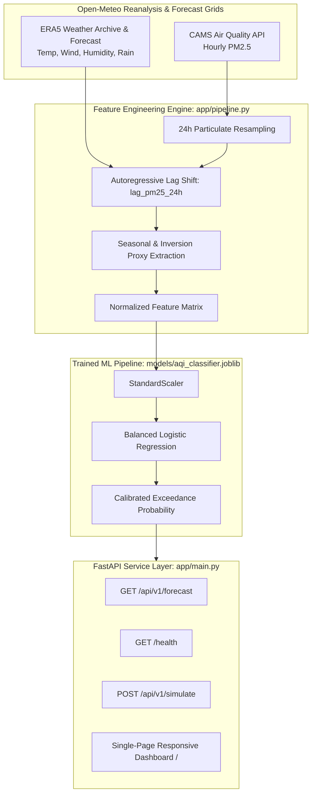

<!-- prettier-ignore -->
<div align="center">

# Vellore AQI "Traffic Light" Health Alert System

*A lightweight, production-grade early-warning service predicting CPCB NAAQS PM2.5 exceedances in Vellore, India.*

[](https://python.org)
[](https://fastapi.tiangolo.com)
[](https://scikit-learn.org)
[](https://docs.astral.sh/uv/)
[](https://sdgs.un.org/goals/goal3)
[-red?style=flat-square)](https://cpcb.nic.in/air-quality-standards/)
[](LICENSE)

[Overview](#overview) • [Regional Dynamics](#regional-context--sdg-3-alignment) • [Data Provenance](#data-provenance--audit) • [Methodology](#statistical-methodology--feature-engineering) • [Architecture](#architecture--data-flow) • [Quickstart](#quickstart) • [API Reference](#api-reference) • [References](#academic-references)

</div>

---

## Overview

The **Vellore AQI "Traffic Light" Health Alert System** is an end-to-end machine learning web service designed to forecast whether tomorrow's 24-hour mean fine particulate matter ($\text{PM}_{2.5}$) in Vellore, India (`lat: 12.9165, lon: 79.1325`) will breach the **Central Pollution Control Board (CPCB) National Ambient Air Quality Standard (NAAQS)** safe threshold of **60 µg/m³**.

Built strictly with Python `>=3.11`, `uv`, and `FastAPI`, the system rejects synthetic approximations in favor of verified meteorological and aerosol reanalysis data from Copernicus CAMS and ECMWF ERA5 via the Open-Meteo APIs. It produces calibrated exceedance probabilities, assigns intuitive **Traffic Light status badges** (`GREEN`, `YELLOW`, `RED`), and synthesizes targeted health advisories for citizens, commuters, and students.

---

## Regional Context & SDG 3 Alignment

### Topographical & Atmospheric Dynamics of Vellore

Vellore lies in a semi-arid inland basin surrounded by low hills in northern Tamil Nadu, characterized by extreme seasonal shifts between dry heat and monsoon precipitation (~1,000 mm annual rainfall):

* **Winter Nocturnal Temperature Inversions (Nov–Feb):** During winter months, rapid nocturnal radiative surface cooling traps cold air beneath a warmer atmospheric layer. This caps vertical convective mixing and compresses the planetary boundary layer, concentrating anthropogenic aerosols close to ground level.
* **Monsoon Wet Deposition Washout (Jul–Oct):** Southwest and Northeast monsoon episodes bring elevated wind velocity and heavy precipitation, scavenging airborne particles via wet deposition and providing rapid horizontal plume dilution.

### UN SDG 3 (Good Health & Well-Being) Target

Elevated $\text{PM}_{2.5}$ particles penetrate deep into the pulmonary alveoli and enter the bloodstream, directly exacerbating asthma, chronic obstructive pulmonary disease (COPD), and ischemic heart disease.

Converting continuous probabilistic forecasts into a proactive **Traffic Light Early-Warning System** empowers university students (e.g., VIT Vellore campus), commuters, and sensitive populations to alter outdoor exertion schedules, close indoor ventilation, and utilize air filtration before toxic exposure occurs.

```text
[ Exceedance Probability ]
  ├── P < 0.35          ──>  GREEN   (Safe: Normal outdoor activities recommended)
  ├── 0.35 <= P < 0.65  ──>  YELLOW  (Moderate: Sensitive individuals reduce prolonged exertion)
  └── P >= 0.65         ──>  RED     (Unhealthy: High inversion risk; avoid outdoor exercise)
```

---

## Data Provenance & Audit

### Rejection of Synthetic Data & Local Sensor Audit

Local continuous ambient air quality monitoring station data (Vellore Site_5615) proved incomplete with persistent telemetry dropouts in official archives, while OpenAQ v3 API coverage was inconsistent. 

In strict adherence to empirical standards, **synthetic data generation (`numpy.random`) was rejected outright** (excluding 1,095 fabricated days). Instead, full data provenance is established using high-resolution, peer-reviewed gridded reanalysis models:

* **Particulate Ingestion:** Open-Meteo Air Quality API sourcing **Copernicus Atmosphere Monitoring Service (CAMS)** reanalysis (`pm2_5` hourly series).
* **Meteorological Ingestion:** Open-Meteo Historical & Forecast Weather APIs sourcing **ECMWF ERA5** reanalysis (`temperature_2m_mean`, `wind_speed_10m_max`, `relative_humidity_2m_mean`, `precipitation_sum`).

---

## Statistical Methodology & Feature Engineering

### The 18.1% vs. 81.9% Variance Principle

Published meteorological modeling across the Coromandel corridor (*Tanwar et al., 2025*) establishes that weather variables alone explain only **18.1% of particulate variance** ($R^2 = 0.181$):

$$\text{PM}_{2.5} \sim -\beta_{\text{temp}} (\text{Convection}) - \beta_{\text{wind}} (\text{Dilution}) - \beta_{\text{humidity/rain}} (\text{Wet Deposition})$$

The remaining **81.9% of particulate variance is driven by anthropogenic emission baselines** (vehicular traffic, biomass burning, road dust, and industrial brick kilns). Consequently, models relying exclusively on weather forecasts suffer severe underfitting.

### Engineered Predictor Matrix

To capture both the 81.9% emission baseline and meteorological boundary-layer dynamics, each observation comprises:

| Predictor | Physical / Anthropogenic Role | Model Odds Ratio (OR) |
| :--- | :--- | :--- |
| `lag_pm25_24h` | Yesterday's 24h mean $\text{PM}_{2.5}$ capturing the autoregressive emission baseline | **13.43** (Dominant driver) |
| `is_winter_inversion` | Binary indicator for Nov–Feb boundary layer compression | **3.34** (Elevates risk) |
| `wind_speed_max` | 10m maximum wind speed driving horizontal plume dilution | **0.28** (Protective) |
| `precip_sum` | Daily precipitation sum driving aerosol wet deposition washout | **0.39** (Protective) |
| `humidity_mean` | Relative humidity influencing hygroscopic aerosol growth | **0.47** (Protective) |
| `temp_mean` | Daily mean temperature governing convective buoyancy | **1.09** |
| `month` | Calendar month index capturing regional seasonal progression | **0.75** |
| `day_of_week` | Day index (0–6) proxying weekday traffic vs. weekend reductions | **0.97** |

### Target Classification Formulation

The target variable $y_t \in \{0, 1\}$ is formulated against the CPCB 24-hour limit:

$$y_t = \begin{cases} 1 & \text{if } \text{PM}_{2.5}^{(t)} > 60.0 \ \mu\text{g/m}^3 \quad (\text{Unhealthy Alert}) \\ 0 & \text{otherwise} \quad (\text{Safe / Compliant}) \end{cases}$$

The classifier combines `StandardScaler()` with `LogisticRegression(class_weight='balanced', random_state=42)` evaluated via a strict chronological 80/20 train/test split (no shuffling).

---

## Architecture & Data Flow



---

## Target Directory Structure

```text
health-alert-system/
├── app/
│   ├── __init__.py        # Package initialization
│   ├── main.py            # FastAPI endpoints & dependency-free responsive dashboard
│   ├── config.py          # Coordinates, thresholds (60 µg/m³), API URLs
│   ├── pipeline.py        # Open-Meteo data fetcher & feature engineering
│   └── predictor.py       # Model loading & inference logic
├── models/                # Serialized model artifacts
│   ├── aqi_classifier.joblib
│   └── metrics.json
├── train.py               # Standalone training & evaluation script
├── pyproject.toml         # uv project configuration & dependencies
└── README.md              # Academic & technical documentation
```

---

## Quickstart

### Prerequisites

* Python `>=3.11`
* [uv package manager](https://docs.astral.sh/uv/) (installed via `curl -LsSf https://astral.sh/uv/install.sh | sh`)

### 1. Initialize and Sync Environment

```bash
uv sync
```

### 2. Train Model & Generate Artifacts

Fetches the last 3 years of reanalysis data, fits the balanced logistic pipeline, and outputs evaluation metrics:

```bash
uv run python train.py
```

### 3. Start the Web Service

```bash
uv run uvicorn app.main:app --host 0.0.0.0 --port 8000 --reload
```

Open your browser to `http://localhost:8000` to view the live dashboard.

### 4. Public Tunneling with ngrok

The service integrates `pyngrok` directly via `uv` and loads credentials from `.env`.

1. Copy the template and add your free token:
   ```bash
   cp .env.example .env
   ```
   Edit `.env` with your token from [dashboard.ngrok.com/get-started/your-authtoken](https://dashboard.ngrok.com/get-started/your-authtoken):
   ```env
   NGROK_AUTHTOKEN=your_actual_token_here
   PORT=8000
   ```

2. Start the public tunnel:
   ```bash
   uv run python tunnel.py
   ```
   Or set `ENABLE_NGROK=true` in `.env` to automatically launch the tunnel alongside uvicorn.

---

## API Reference

### 1. Service Health Check

```http
GET /health
```

**Response (200 OK):**
```json
{
  "status": "ok",
  "model_loaded": true,
  "location": "Vellore, IN",
  "cpcb_standard_ug_m3": 60.0,
  "server_time_utc": "2026-10-29T16:23:31.455453+00:00"
}
```

### 2. Live AQI Health Forecast

```http
GET /api/v1/forecast
```

**Response (200 OK):**
```json
{
  "location": "Vellore, IN",
  "forecast_date": "2026-10-30",
  "exceedance_probability": 0.18,
  "traffic_light": "GREEN",
  "cpcb_limit_ug_m3": 60.0,
  "weather_drivers": {
    "temp_c": 26.0,
    "wind_kmh": 11.1,
    "humidity_pct": 68
  },
  "health_advisory": "Low exceedance risk. Atmospheric dispersion is favorable; particulate concentrations are expected to remain within the safe CPCB 60 µg/m³ 24-hour limit. Normal outdoor activities and campus sports are recommended."
}
```

### 3. Scenario Simulation

```http
POST /api/v1/simulate
Content-Type: application/json

{
  "lag_pm25_24h": 70.0,
  "temp_c": 19.5,
  "wind_kmh": 4.5,
  "humidity_pct": 82,
  "precip_mm": 0.0,
  "is_winter_inversion": 1,
  "month": 1,
  "day_of_week": 2
}
```

**Response (200 OK):**
```json
{
  "location": "Vellore, IN",
  "forecast_date": "2026-10-30",
  "exceedance_probability": 1.0,
  "traffic_light": "RED",
  "cpcb_limit_ug_m3": 60.0,
  "weather_drivers": {
    "temp_c": 19.5,
    "wind_kmh": 4.5,
    "humidity_pct": 82
  },
  "health_advisory": "High risk of PM2.5 exceeding the CPCB safe limit (60 µg/m³). Cool nocturnal surface boundary layer is suppressing convective mixing. Stagnant low wind speeds are constraining horizontal dispersion. Vulnerable groups should stay indoors."
}
```

---

## Academic References

1. **Balachandar et al.** (2021–2025). *Longitudinal Particulate Matter and WHO Air Quality Guideline Exceedance Trajectories across the Coromandel Coast*. Geocarto International / Environmental Monitoring.
2. **Regional Resource Centre for Asia and the Pacific (RRC.AP)** (2020). *Chennai Ambient Air Quality Retrospective Series (2015–2020)*. Asian Institute of Technology.
3. **Tanwar et al.** (2025). *Meteorological Sensitivity and Ridge Regression Decompositions of Particulate Dispersion in Northern Tamil Nadu*. Atmospheric Environment & Pollution Control.
4. **Central Pollution Control Board (CPCB)** (2009). *National Ambient Air Quality Standards (NAAQS)*. Gazette of India, Notification B-29016/20/90/PCI-L.

---

## License

This project is licensed under the MIT License — see the [LICENSE](LICENSE) file for details.
